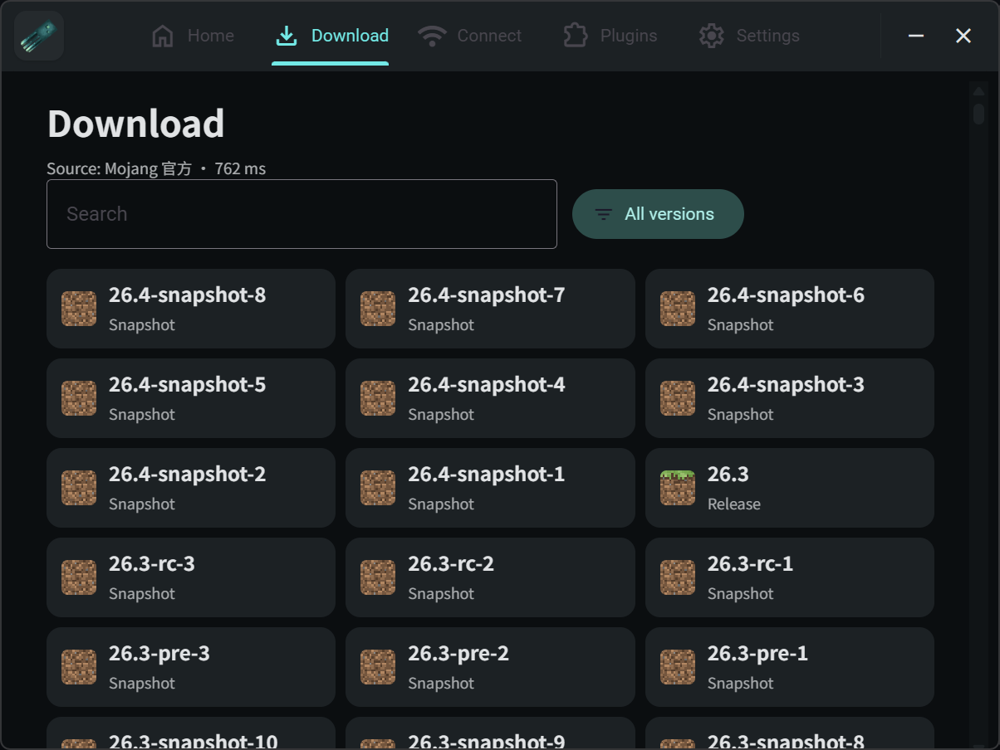

<p align="center">
  
</p>
<h1 align="center">Glow Squid Minecraft Launcher</h1>
<h3 align="center">Mojang made glow squids glow. We made them useful.</h3>

<p align="center">
  <a href="https://github.com/C-S-E-C/gsml/actions/workflows/build.yml">
    
  </a>
</p>

---

## Overview

**Glow Squid** (GSML) is a lightweight, modern Minecraft launcher built with a focus on
clean UX and deep-link integration. Install and launch game versions directly from your
browser or any external app via the `glow-squid://` URL scheme.

## Screenshots

| Home | Download |
| :---: | :---: |
|  |  |

## Deep Linking API

Glow Squid registers the `glow-squid://` protocol, so you can trigger installs and game
launches from any link — a website, a Discord message, or your own tooling.

### Install a version

```
glow-squid://install-version?version=1.20.1&loader=forge&loaderVersion=47.4.0&name=MyInstance
```

| Parameter | Required | Description |
| --- | :---: | --- |
| `version` | ✅ | Minecraft version, e.g. `1.20.1` |
| `loader` | — | Mod loader: `forge`, `fabric`, `quilt`, `neoforge` |
| `loaderVersion` | — | Loader version, e.g. `47.4.0` |
| `name` | — | Instance display name, e.g. `MyInstance` |

### Launch the game

```
glow-squid://start-game?version=1.21.1&server=play.example.com:25565
```

| Parameter | Required | Description |
| --- | :---: | --- |
| `version` | — | Minecraft version to launch |
| `server` | — | Server address to join on start, `host:port` |


## Third-Party Components

This project redistributes several third-party components. Full license texts are
reproduced in [`THIRD_PARTY_LICENSES`](public/THIRD_PARTY_LICENSES.html).
